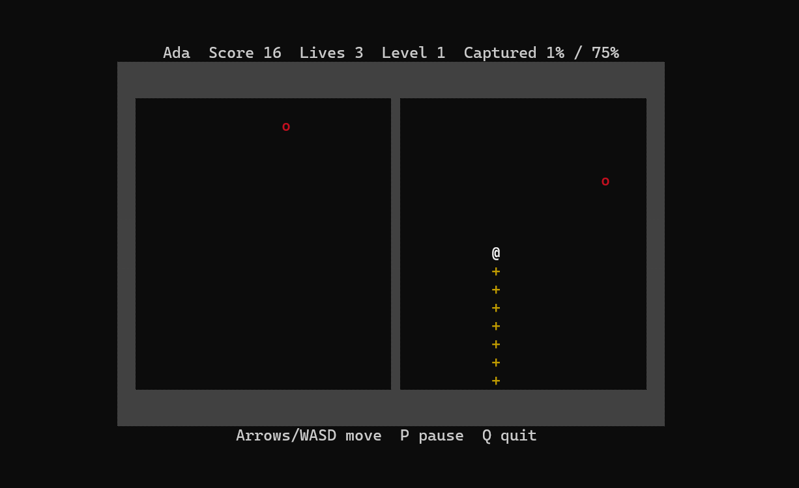
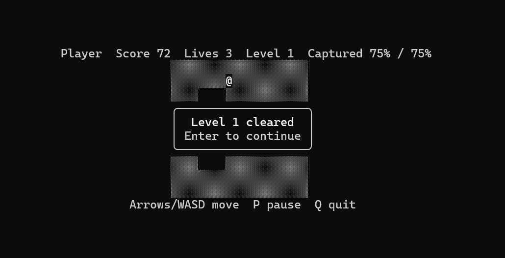

# XonixM23 — Modern C++23

A small terminal territory-capture game: draw trails across the board, enclose area away from the enemies, and clear each level. It is a noncommercial project for learning and testing modern C++.

C++23, FTXUI, CMake, Clang; Windows, Linux, macOS

## Screenshots



*Active gameplay on the default board.*



*Level progression: the "Level 1 cleared" overlay on a 20x10 board.*

## Quick start

### Prerequisites

- **Windows:** Clang (LLVM), CMake 3.25 or newer, Ninja, and Visual Studio Build Tools (MSVC STL and Windows SDK). `clang++` finds them without a developer prompt.
- **Linux:** Clang 19 or newer with libstdc++ 13 or newer (tested with libstdc++ 14), CMake 3.25 or newer, Ninja, and Git. If the default `clang++` is older, add `-DCMAKE_CXX_COMPILER=clang++-19` (or newer) to the configure command: `cmake --preset release -DCMAKE_CXX_COMPILER=clang++-19`.
- **macOS:** Apple Clang 16+ (Xcode 16) or Homebrew LLVM 19+, CMake 3.25 or newer, and Ninja. Expected to work; untested.
- All platforms need network access on the first configure, because FTXUI v7.0.3 is fetched then.

### Build, test, run

```text
cmake --preset release
cmake --build --preset release
ctest --preset release
```

Run (default 60x20 board):

```powershell
.\build\release\xonixm23.exe
```

```sh
./build/release/xonixm23
```

Custom board size (width 20-200, height 10-80):

```powershell
.\build\release\xonixm23.exe --width 80 --height 30
```

```sh
./build/release/xonixm23 --width 80 --height 30
```

Other presets: `debug` and `sanitize` (build directories are `build/<preset>/`). `--help` prints the usage.

The terminal must be at least `max(board width, name width + 56, 36)` columns by `board height + 2` rows. The middle term is the status line with your name at its widest (score 9999999, level 999, 100%), and 36 fits the dialogs. With the default 60x20 board that is 60 to 72 columns (62 for `Player`) by 22 rows. The size is fixed when a game starts. If the terminal is too small, the game pauses and shows the required size; press P to resume after enlarging it.

### Prebuilt binaries

CI builds and tests every push on Windows x64, Linux x64, and macOS arm64, and keeps the archives as workflow artifacts on the [Actions](https://github.com/BarabashkaD/XonixM23/actions) page. Each version tag (for example `v0.1.0`) also publishes them on the [Releases](https://github.com/BarabashkaD/XonixM23/releases) page.

- **Windows:** uses the static C++ runtime, so no Visual C++ redistributable is needed.
- **Linux:** links libstdc++ statically; needs glibc 2.38 or newer (for example Ubuntu 24.04 or Debian 13).
- **macOS:** the binary is not signed. If macOS blocks it, run `xattr -d com.apple.quarantine xonixm23`.

### Controls

On the name screen, type a name (up to 16 characters; empty becomes `Player`), then press Enter to start or Esc to quit.

| Action | Keys |
|---|---|
| Move | Arrow keys or WASD |
| Pause / resume | P or Space |
| Continue after a cleared level | Enter |
| Restart after game over (same name) | R |
| Quit | Q or Esc |

### Rules and defaults

- Claim territory by leaving the claimed border, drawing a trail (`+`) through unclaimed space, and returning to claimed ground. The area not reachable by enemies is claimed.
- The player keeps moving in the last direction. It stops at the board edge and after a capture. Reversing 180 degrees while drawing a trail is ignored.
- An enemy touching the player or the trail costs one life; the trail is removed and the player returns to the top border.
- 3 lives, +1 per cleared level, maximum 9. The game ends at 0 lives.
- A level is cleared at 75% of the interior claimed. Each newly claimed cell scores the current level number.
- Enemies: 2 at level 1, +1 per level, maximum 12. They move one cell per 100 ms at level 1, speeding up to one per 40 ms. The player moves one cell per 60 ms.
- The board is 60x20 with a 2-cell claimed border. The simulation uses a fixed 10 ms step.
- Cells are told apart by glyph, so colour is optional (`NO_COLOR` is honoured): `▒` claimed, blank unclaimed, `+` trail, `@` player, `o` enemy.
- All gameplay defaults live in `xonix::Rules` in `src/settings.hpp`.

## History and acknowledgments

XonixM23 belongs to a long territory-capture tradition. The notes below are limited to what the cited sources state. This is not an exhaustive list of versions or ports.

- **1981, Qix (original arcade game).** Taito's "Taito Milestones" page lists Qix (1981) as an arcade territory-capture game released in 1981. Source: <https://www.taito.co.jp/taitomilestones/titles>
- **1984, Xonix for DOS (original creators of Xonix).** The old-games.org entry lists Ilan Rav and Dani Katz as developers of the 1984 DOS game. An article on the Israeli news site ynet says it was developed in 1984 by Ilan Rav and Dani Katz during their military service. Sources: <https://www.old-games.org/games/xonix> and <https://www.ynet.co.il/articles/0,7340,L-4368049,00.html>
- **Soviet computing context.** In his first-person account of the early history of Tetris, Vadim Gerasimov describes Antix (short for Antixonix, named by Dmitry Pavlovsky), an early game of his team and a remake of Xonix with an inverted hidden play field. He writes that Antix "was a smashing success at the Computer Center and elsewhere around Moscow", and that he does not know who developed the original Xonix. Antix is mentioned only as a related historical branch: it is not claimed to be an ancestor of the Radio-86RK version, and Xonix is not claimed to have inspired Tetris. Source: <https://vadim.oversigma.com/Tetris.htm>
- **1987, Radio-86RK adaptation (adaptation author, as attributed by an archive).** The rk86.ru catalog lists the file `XONIX-S.RKR` with the author line "Седов E., Москва, 1987" (E. Sedov, Moscow) and a loaded length of 2048 bytes. This credit applies to that specific version only, not to every Radio-86RK adaptation. The catalog also lists other Xonix versions labelled "МИКРОН" (MIKRON); that label is not a verified individual author, and no authors are claimed for them. rk86.ru is an archive, and its maintainers are not the authors of the programs it lists. Source: <https://rk86.ru/catalog/>

XonixM23 is a new, independently written implementation inspired by this tradition. It contains no code, binaries, or assets from earlier games. Historical attribution does not imply official affiliation, endorsement, permission, or a license from earlier authors, and XonixM23 is not affiliated with Taito, the authors named above, or the archives cited.

## Dependencies, license, and limitations

- [FTXUI](https://github.com/ArthurSonzogni/FTXUI) (MIT license) provides the terminal UI. It is pinned to v7.0.3 and fetched by CMake at configure time.
- The code of this project is released under the MIT license (see `LICENSE`). The license covers only this project's own code, not earlier games or third-party materials.

### Tested platforms and toolchain

| Platform | Status | Toolchain |
|---|---|---|
| Windows 11, Windows Terminal | Tested: all three presets build, `ctest` passes, manual smoke test passed (name entry, capture, death and respawn, pause, resize, level progression, game over and restart, quit) | Clang 23.1.4 (`x86_64-pc-windows-msvc`), MSVC STL 14.51 (VS Build Tools 2026, 18.11), Windows SDK 10.0.26100, CMake 4.3.2, Ninja 1.13.2. `clang++` found the STL and SDK without a developer prompt. |
| Linux (Ubuntu 24.04.5 LTS under WSL2, not bare-metal Linux) | Tested: `debug`, `release` and `sanitize` (ASan + UBSan) build with no warnings and `ctest` passes. Short interactive check in Windows Terminal through WSL: name entry, capture, resize auto-pause and resume state, quit. `--width 19` exits with code 2 and `--help` with 0. | Clang 19.1.1, libstdc++ 14, CMake 3.28.3, Ninja 1.11.1. `<format>` is used, which needs libstdc++ 13 or newer. |
| macOS | Untested | Expected, not verified: Apple Clang 16+ (Xcode 16) or Homebrew LLVM 19+. |

### Known limitations

- One terminal column per cell, so cells are not square and horizontal movement looks faster than vertical.
- Terminals report no key-release events, so movement is continuous instead of hold-to-move.
- An enemy in a corridor one cell wide cannot move diagonally and stays put.
- The board is not scaled to the terminal; the terminal must fit the board plus two rows and the widest status line (see Quick start).
- Only macOS is untested. Linux was tested only under WSL2, not on bare-metal Linux.

## How this project was made

XonixM23 was created in a single Claude Code session by an AI agent (Claude Opus 5.5), working from the specification in [`docs/XonixM23-prompt.txt`](docs/XonixM23-prompt.txt). The agent asked the user only a few clarifying questions, such as the license, the Linux toolchain, and publishing options. It planned the work, wrote the code, tests, CI configuration, and documentation, and verified them with independent reviewer agents and with builds, tests, and interactive runs on Windows and Linux.
